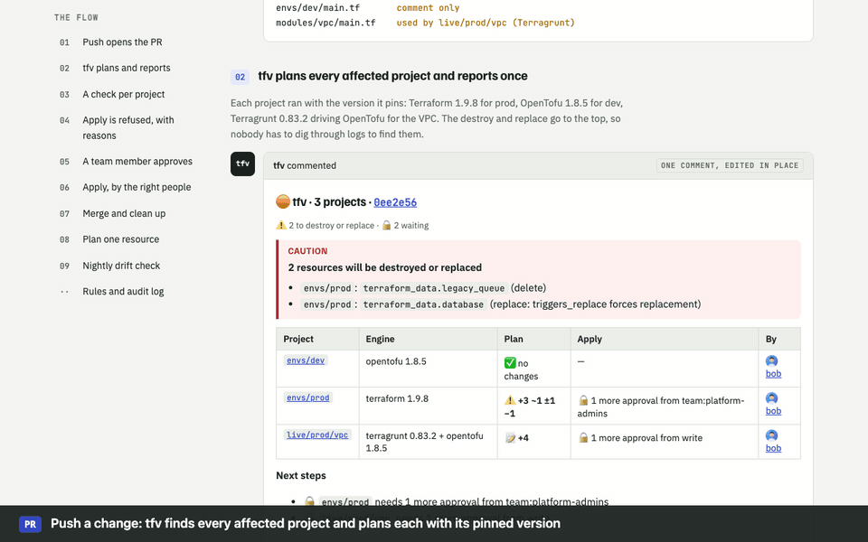

# tfv-server Helm chart

Runs [tfv server](../../packages/server/README.md) on Kubernetes. It's pull request automation
for Terraform, OpenTofu and Terragrunt, with per-project RBAC and approvers, drift alerts, and a
dashboard.



## Install

```sh
kubectl create namespace tfv
kubectl -n tfv create secret generic tfv-github \
  --from-file=private-key=app.pem --from-literal=webhook-secret="$WEBHOOK_SECRET"

helm install tfv oci://ghcr.io/marcdomain/charts/tfv-server -n tfv -f values.yaml
```

```yaml
# values.yaml
github:
  appId: "123456"
  existingSecret: tfv-github
config:
  repoAllowlist: [github.com/acme/*]
  requireApplyProject: true           # one project per apply: tfv apply -p <project>
httpRoute:
  enabled: true
  parentRefs: [{ name: public-gateway, namespace: gateway-system }]
  hostnames: [tfv.acme.dev]
dashboard:
  oidc:
    enabled: true
    issuer: https://acme.okta.com/oauth2/default
    clientId: 0oa1b2c3d4
    existingSecret: tfv-okta          # key: client-secret
    adminGroups: [platform-admins]
```

Then:
1. Point the GitHub App's webhook at `https://tfv.acme.dev/events/github`.
2. Register `https://tfv.acme.dev/auth/oidc/callback` as the redirect URI with Okta.
3. Check the install with `helm test tfv -n tfv`.

## Routing

| Option | Values | Notes |
|---|---|---|
| **Gateway API** (recommended) | `httpRoute.*` | An `HTTPRoute` attached to your Gateway (Envoy Gateway, Istio, Cilium, NGINX Gateway Fabric, GKE, …) |
| Ingress | `ingress.*` | For clusters that still use an Ingress controller |
| None | `service.type` | Port-forward, or your own mesh routing |

To expose only the webhooks publicly, narrow the rule. Reach the dashboard through an internal
gateway or `kubectl port-forward`:

```yaml
httpRoute:
  rules:
    - matches: [{ path: { type: PathPrefix, value: /events/ } }]
```

## Dashboard sign-in

| Method | Values | Roles |
|---|---|---|
| Okta / any OIDC provider | `dashboard.oidc.*` | `adminGroups` → admin, `allowedGroups` → viewer, everyone else is refused |
| Username and password | `dashboard.users` or `usersExistingSecret` | `role: admin` or `viewer` per user |
| API token | `dashboard.apiToken.existingSecret` | Admin. For automation and `/api` |

Viewers can see everything. Admins can also release locks and start drift checks.

Make password hashes with `node packages/server/src/hash-password.ts`. Sessions are signed,
HttpOnly cookies. The chart generates the signing key once and keeps it across upgrades.

## Common values

| Value | Default | |
|---|---|---|
| `github.appId` / `github.existingSecret` | | **Required.** App ID, and a Secret with `private-key` and `webhook-secret` |
| `github.apiUrl` | | GitHub Enterprise Server API URL |
| `config.repoAllowlist` | `[]` | Repos tfv may act on, e.g. `github.com/acme/*` |
| `config.requireApplyProject` | `false` | Refuse a bare `tfv apply`; one project at a time |
| `config.ackReaction` | `eyes` | Reaction on a command tfv picked up: `eyes`, `rocket`, `+1`, `heart`, `hooray`, `laugh`, `confused`, `-1` or `none` |
| `config.progressReply` | `true` | A spinning "Running…" reply under the command that turns into the result. Needs a public https URL; skipped otherwise |
| `config.commentMode` | `new` | `new`: a new comment for each plan and apply. `update`: one comment at the top, edited in place |
| `config.parallelism` | `4` | Plans running at once |
| `config.preinstall` | `[]` | e.g. `[terraform@1.9.8, tofu@1.8.5]` |
| `repos` | `{}` | Full `repos.yaml`: rules, approvers, channels, people, drift schedules |
| `extraEnvFrom` / `extraEnv` | `[]` | Cloud credentials, `TFV_SLACK_TOKEN`, `TFV_TEAMS_WEBHOOK`, … |
| `serviceAccount.annotations` | `{}` | Workload identity: IRSA, GKE, Azure |
| `persistence.size` | `20Gi` | Checkouts, saved plans, binaries, provider cache, database |
| `serviceMonitor.enabled` | `false` | Prometheus scraping of `/metrics` |
| `podDisruptionBudget.enabled` | `false` | Stop node drains from interrupting an apply |
| `networkPolicy.enabled` | `false` | Allow inbound traffic only from `networkPolicy.ingressFrom` |

## Rules in values

```yaml
repos:
  channels:
    infra-alerts: { type: slack, channel: "#infra-drift", token_env: TFV_SLACK_TOKEN }
  repos:
    - id: github.com/acme/infra
      projects:
        - match: prod/**
          permissions: { apply: [team:platform-admins], apply_destroy: [admin] }
          approvals: [{ from: team:platform-admins, count: 2 }]
      drift:
        - { name: prod-nightly, projects: ["prod/**"], schedule: "0 6 * * 1-5", timezone: Europe/Berlin, notify: [infra-alerts] }
extraEnvFrom:
  - secretRef: { name: tfv-chat-tokens }   # holds TFV_SLACK_TOKEN
```

## How it runs

- **One replica, as a StatefulSet.** Locks and history are kept in SQLite on the volume.
- **Locked down.** It runs as non-root (uid 10001) with a read-only root filesystem, all Linux
  capabilities dropped, and the `RuntimeDefault` seccomp profile.
- **Applies finish before shutdown.** `terminationGracePeriodSeconds: 3600` lets a running apply
  finish on upgrades.
- **Config changes roll the pod.** Checksums of the config, secrets and dashboard settings are pod
  annotations.
